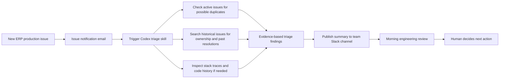

# IssuePilot

**AI-assisted enterprise issue triage — engineering leadership portfolio case study**

> **Independent portfolio case study.** The production experience described here is real, but this public repository is an independently written, genericized reconstruction. It is **not** the original employer-owned Codex skill, source code, prompt, incident history, or integration configuration. Fictional examples are explicitly labeled. No employer or vendor endorses this project.

## At a glance

| Dimension | What happened |
| --- | --- |
| Production-used V1 | A **Codex skill** triggered when an issue-notification email arrived in the team inbox |
| Operating volume | Approximately **40–50 incoming issues per month** |
| Adoption | Used for **every incoming issue** in the team's process for several months |
| Collaboration | Co-developed with a **peer engineering manager** |
| Delivery | Findings were published to a **Slack channel** for engineers' morning review |
| Decisions | **Human-approved** recommendations; no autonomous production fixes |
| Feedback | Positive qualitative feedback; **no measured time-savings or accuracy rates** |
| Proposed V2 | Affected-release analysis, isolated candidate fix, automated validation, and a **draft merge request** — **not implemented** |

## The problem

Incoming ERP production issues often required repetitive historical issue searches, team-routing decisions, past-remediation review, and, when necessary, examination of stack traces and recent changes. These tasks could consume engineers' initial investigation time and depended on knowledge distributed across older issues.

## The V1 approach — production-used

An incoming issue-notification email triggered a Codex skill. The skill retrieved the issue, checked **other still-open issues for potential duplicates**, searched historical issues for ownership and remediation clues, recommended the likely owning team, recognized recurring resolution patterns, and investigated code history when useful. It posted an **advisory** report to Slack. Engineers reviewed the findings during their regular morning triage and independently chose whether to act.

The diagram is conceptual and omits private implementation details; it is not a copy of the employer's infrastructure.

## Production lessons

- **Potential duplicates need human confirmation.** Similar open issues can be related without representing the same defect; the skill suggested candidates rather than automatically closing or merging issues.
- **Historical recommendations are fallible.** Some older issues referenced backend switches that had since been deprecated.
- **Data fixes require domain expertise.** Customer production data changes were never appropriate to authorize solely from AI output.
- **Probable cause is not proven cause.** Recent commits and stack traces require human validation.
- **Adoption matters.** Integrating results into an existing Slack-based morning review made the output available within the team's normal workflow.
- **Evidence limitations matter.** Feedback was positive, but no rigorous before/after productivity or precision measurements were gathered.

## V1 versus proposed V2

| Capability | Production-used V1 | Planned V2 |
| --- | :---: | :---: |
| Email-triggered Codex triage | Yes | Retain |
| Potential duplicate detection among still-open issues | Yes | Improve |
| Historical issue retrieval and team suggestions | Yes | Improve |
| Resolution-pattern and possible regression investigation | Yes | Improve |
| Slack reporting and human review | Yes | Retain |
| Supported-release branch impact matrix | No | Planned |
| Create isolated fix branch, test candidate changes | No | Planned |
| Prepare a **draft** merge request | No | Planned |
| Autonomous production changes | No | **Not proposed** |

## Explore the case study

- [V1 production case study](docs/v1-production-case-study.md) — problem, collaboration, workflow, evidence, outcomes and lessons.
- [Conceptual architecture](docs/architecture.md) — integration boundaries, sequence and triage decision logic.
- [V2 roadmap](docs/v2-roadmap.md) — branch impact, candidate fixes, validation and human gates.
- [Evaluation and safeguards](docs/evaluation-and-guardrails.md) — proposed future metrics, precision checks and risk controls.
- [Architecture diagrams](docs/diagrams/) — editable Mermaid sources.
- [Fictional triage example](examples/synthetic-triage-report.md) and [synthetic issue fixtures](examples/synthetic-issues.json).

## Project status and intended audience

This repository is **documentation and synthetic examples**, not a runnable reproduction of the original skill. It is intended to demonstrate practical AI adoption, operational judgment, collaboration between engineering managers, and incremental engineering planning for Engineering Manager and Senior Engineering Manager audiences.

**Privacy and IP boundary:** No proprietary prompts, incident payloads, customer information, source code, authentication details, or internal issue identifiers belong in this repository. See [publication notice](NOTICE.md).
