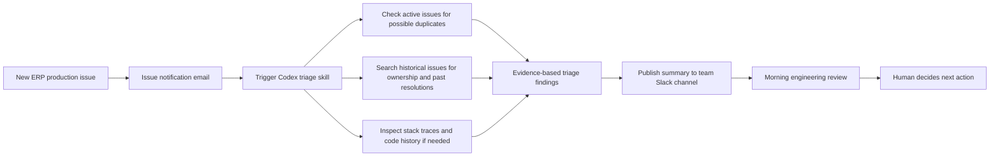

# IssuePilot

**AI-assisted enterprise issue triage — engineering leadership portfolio case study**

> **Independent portfolio case study.** The production experience described here is real, but this public repository is an independently written, genericized reconstruction. It is **not** the original employer-owned Codex skill, source code, prompt, incident history, or integration configuration. Fictional examples are explicitly labeled. No employer or vendor endorses this project.

## Video demo — AI-assisted engineering issue triage

**IssuePilot: AI-Assisted Engineering Issue Triage | Architecture & Live Demo** · 6 min 36 sec

[**Watch the IssuePilot demonstration (MP4)**](docs/demo/IssuePilot-AI-Assisted-Engineering-Issue-Triage-Demo.mp4)

The video introduces the operational triage challenge, outlines the original human-reviewed email-to-Codex-to-Slack workflow, and demonstrates a separate Java/Spring Boot/Vaadin proof of concept that analyzes a fictional issue using Codex. It also shows synthetic evaluation scenarios and their limitations.

**Portfolio/IP distinction:** The production workflow was co-developed with another engineering manager; the recorded application and issue history are independently created and synthetic. The demo does not show employer-owned code, prompts, or real customer issues.

## At a glance

| Dimension | What happened |
| --- | --- |
| Production-used V1 | A **Codex skill** triggered when an issue-notification email arrived in the team inbox |
| Operating volume | Approximately **40–50 incoming issues per month** |
| Adoption | Used for **every incoming issue** in the team's process for several months |
| Collaboration | Co-developed with a **peer engineering manager** |
| Delivery | Findings were published to a **Slack channel** for engineers' morning review |
| Decisions | **Human-approved** recommendations; no autonomous production fixes |
| Feedback | Positive qualitative feedback; **no measured time-savings or accuracy rates** |
| Proposed V2 | Affected-release analysis, isolated candidate fix, automated validation, and a **draft merge request** — **not implemented** |

## The problem

Incoming ERP production issues often required repetitive historical issue searches, team-routing decisions, past-remediation review, and, when necessary, examination of stack traces and recent changes. These tasks could consume engineers' initial investigation time and depended on knowledge distributed across older issues.

## The V1 approach — production-used

An incoming issue-notification email triggered a Codex skill. The skill retrieved the issue, checked **other still-open issues for potential duplicates**, searched historical issues for ownership and remediation clues, recommended the likely owning team, recognized recurring resolution patterns, and investigated code history when useful. It posted an **advisory** report to Slack. Engineers reviewed the findings during their regular morning triage and independently chose whether to act.



The diagram is conceptual and omits private implementation details; it is not a copy of the employer's infrastructure.

## Production lessons

- **Potential duplicates need human confirmation.** Similar open issues can be related without representing the same defect; the skill suggested candidates rather than automatically closing or merging issues.
- **Historical recommendations are fallible.** Some older issues referenced backend switches that had since been deprecated.
- **Data fixes require domain expertise.** Customer production data changes were never appropriate to authorize solely from AI output.
- **Probable cause is not proven cause.** Recent commits and stack traces require human validation.
- **Adoption matters.** Integrating results into an existing Slack-based morning review made the output available within the team's normal workflow.
- **Evidence limitations matter.** Feedback was positive, but no rigorous before/after productivity or precision measurements were gathered.

## V1 versus proposed V2

| Capability | Production-used V1 | Planned V2 |
| --- | :---: | :---: |
| Email-triggered Codex triage | Yes | Retain |
| Potential duplicate detection among still-open issues | Yes | Improve |
| Historical issue retrieval and team suggestions | Yes | Improve |
| Resolution-pattern and possible regression investigation | Yes | Improve |
| Slack reporting and human review | Yes | Retain |
| Supported-release branch impact matrix | No | Planned |
| Create isolated fix branch, test candidate changes | No | Planned |
| Prepare a **draft** merge request | No | Planned |
| Autonomous production changes | No | **Not proposed** |

## Explore the case study

- [V1 production case study](docs/v1-production-case-study.md) — problem, collaboration, workflow, evidence, outcomes and lessons.
- [Conceptual architecture](docs/architecture.md) — integration boundaries, sequence and triage decision logic.
- [V2 roadmap](docs/v2-roadmap.md) — branch impact, candidate fixes, validation and human gates.
- [Synthetic POC evaluation report](docs/poc-evaluation-report.md) — eight hand-reviewed Codex scenarios, observed results, limitations and refinements.
- [Evaluation and safeguards](docs/evaluation-and-guardrails.md) — proposed future metrics, precision checks and risk controls.
- [Architecture diagrams](docs/diagrams/) — editable Mermaid sources.
- [Fictional triage example](examples/synthetic-triage-report.md) and [synthetic issue fixtures](examples/synthetic-issues.json).

## Project status and intended audience

This repository includes the case-study documentation and synthetic examples, along with a committed, independently implemented Java/Vaadin + Spring Boot/H2 local POC, synthetic SQL fixtures, evaluation expectations, integration tests, and the V1 Codex triage skill. The POC is runnable locally using the steps below; it is **not** the original employer-owned production skill or a reproduction of its private integrations. The synthetic evaluation report describes an earlier eight-scenario qualitative baseline; the revised skill instructions have **not yet been rerun** against all eight scenarios. It is intended to demonstrate practical AI adoption, operational judgment, collaboration between engineering managers, and incremental engineering planning for Engineering Manager and Senior Engineering Manager audiences.

**Privacy and IP boundary:** No proprietary prompts, incident payloads, customer information, source code, authentication details, or internal issue identifiers belong in this repository. See [publication notice](NOTICE.md).

## Run the independent local POC

Requirements: JDK 25 or later (the Maven compiler targets Java 25), network access for Maven and Vaadin frontend dependencies, and a browser. The Maven wrapper downloads Maven 3.9.12; a system Maven installation is unnecessary.

From the repository root on Windows PowerShell:

```powershell
.\mvnw.cmd clean verify
.\mvnw.cmd spring-boot:run
```

On macOS/Linux, use `sh ./mvnw clean verify` and `sh ./mvnw spring-boot:run`.
If Maven selects an unwritable cache, add `"-Dmaven.repo.local=$env:USERPROFILE\.m2\repository"` to the Windows commands.

Open <http://localhost:8080/issues> for the searchable/filterable issue grid and <http://localhost:8080/issue/2401> for one issue after seeding. The application binds to loopback and uses an initially empty H2 database at `./data/issuepilot`. Stop with Ctrl+C. Local database files are ignored by Git.

To load the 48 fictional issues, open <http://localhost:8080/h2-console>, use JDBC URL `jdbc:h2:file:./data/issuepilot`, username `sa`, and an empty password. This is the local demo default, not a copied credential. Run the SQL from [test-data/issuepilot_seed_h2.sql](test-data/issuepilot_seed_h2.sql). Verify the seeded count and follow the manual evaluation rubric in [test-data/README.md](test-data/README.md). Do not use real incident data or expose this unauthenticated demo publicly.

The read-only API provides `GET /api/issues` and `GET /api/issues/{id}` (404 for an unknown ID). The SQL fixture is loaded manually; startup does not import it automatically.

## Run AI triage from the Vaadin application (local POC)

IssuePilot also provides a **Run AI Triage** button on the `/issues` detail panel and `/issue/{id}` page. The Spring Boot backend starts the *local Codex CLI* and shows the final advisory report inside Vaadin. This integration is for a **trusted, single-user local demonstration**; it is not a remotely hosted AI service or part of the original internal production integration.

Prerequisites, in addition to the app setup above:

1. Install Codex CLI and sign in **for the same OS user running Java**. Confirm that `codex exec --help` runs from a terminal. The Java process must find the Codex CLI executable on its `PATH`; on Windows the application defaults to `codex.exe`, on macOS/Linux to `codex`.
2. Pull the latest repository files, including `.agents/skills/issue-pilot/SKILL.md`; start Spring Boot from the repository root. Load the synthetic database first.
3. Open `http://localhost:8080/issues`, choose an issue (such as **2408**), and click **Run AI Triage** immediately below the issue heading and status. On completion, the **AI Triage Results** section expands to display the advisory report; you may collapse it while inspecting the issue. The same action is available near the top of `/issue/{id}`. A single triage job runs at a time; the UI shows a running state or a helpful failure message.

If IntelliJ does not inherit your terminal's Codex `PATH`, set the environment variable `CODEX_COMMAND` to the **full path** of the executable (on Windows, for example, the full path to `codex.exe`). If you launch the application outside the repo root, set `ISSUEPILOT_CODEX_WORKSPACE` to the **absolute repository directory** containing the skill. These are also configurable via `issuepilot.codex.executable` and `issuepilot.codex.workspace` in Spring configuration. Restart the app after changing environment variables.

The backend calls `codex exec --ephemeral --sandbox read-only --cd <repo> --output-last-message <temp-file> "$issue-pilot <issue-id>"` using argument-list execution (**no shell interpolation**). A positive numeric issue ID is the only user-derived command input. It imposes a three-minute timeout and allows at most one active invocation. Run state and completed reports are **retained in application memory per issue**, so returning to an issue or refreshing the browser restores its latest report while Spring Boot remains running. They are lost when Spring Boot restarts; reports are not written to H2. The UI displays which issue is active and polls for completion, including timeout and CLI diagnostic output. Temporary Codex output files are deleted after processing; issue records are never modified.

**Important limitations:** Codex uses its own local authentication and may incur usage costs. A read-only Codex sandbox limits agent filesystem modifications but does not make the entire machine safe from arbitrary untrusted code; run this only with trusted local files, not on an internet-facing or shared system. Local REST access from the Codex sandbox varies by platform and configuration; if Codex cannot reach `localhost:8080`, try the skill in a local Codex terminal first and troubleshoot the environment—do **not** disable sandboxing as a shortcut. The Java unit tests validate command construction, not a real Codex end-to-end run. Human review is always required. The launcher closes the child process's standard input immediately after starting Codex to signal EOF; without this, some CLI builds can remain at `Reading additional input from stdin...` until timeout.

## Invoke the Codex triage skill

The complete local skill is at [.agents/skills/issue-pilot/SKILL.md](.agents/skills/issue-pilot/SKILL.md). Open Codex in this repository so it can discover the project skill; start a fresh session if it was opened before the skill was added. With the application running and seeded, invoke:

```text
$issue-pilot 2401
```

Repeat for IDs `2401` through `2408` and compare the evidence with [evaluation expectations](test-data/evaluation_expectations.csv). Codex needs access to the local HTTP endpoints. The skill retrieves the incoming issue, checks other OPEN issues for potential duplicates, searches CLOSED defects and their resolutions, investigates possible feature regressions, identifies relevant automated-test records, and recommends ownership with supporting issue IDs. It reports uncertainty and investigation steps for human review, without changing records. Automated-test issue records describe fictional historical coverage; they are not executable tests in this repository. The skill does not send Slack messages or implement the proposed V2 workflow.

The V1 skill includes explicit checks for misleading duplicate references, deprecated historical remedies, deployment uncertainty, evidence-ranked matches, and functional-owner versus specialist-team recommendations. These refinements were added **after** the initial eight-scenario evaluation; rerun the scenarios before attributing the baseline results to this revision.
