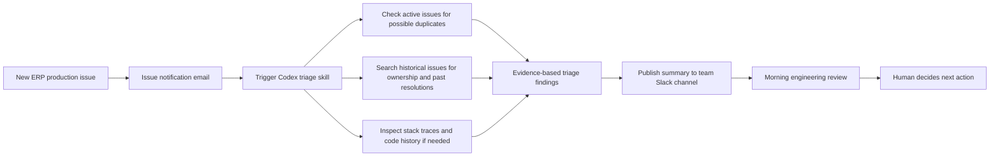
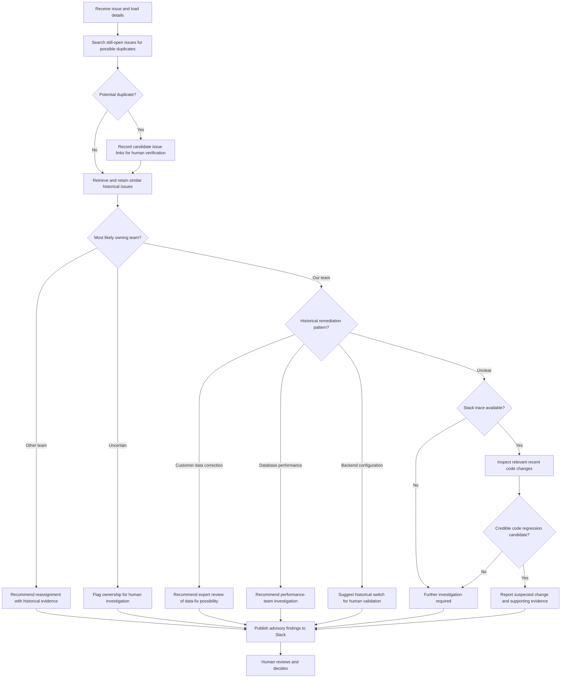
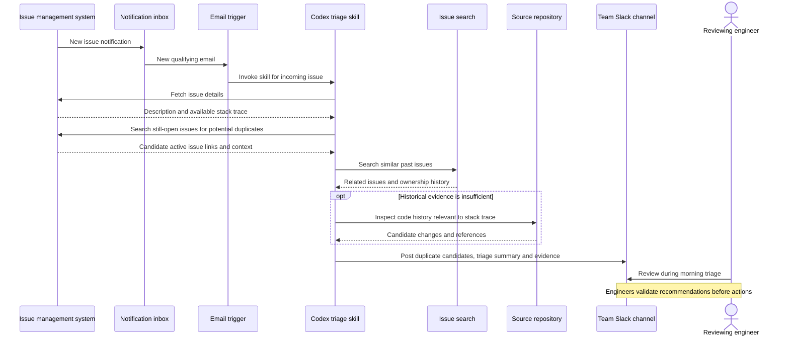

# Architecture — conceptual reconstruction of V1

[← README](../README.md) · [V1 case study](v1-production-case-study.md) · [V2 roadmap](v2-roadmap.md)

> The production system was a **Codex skill triggered by issue-notification email**. These diagrams describe its externally explainable workflow without disclosing the actual employer's infrastructure, source code or prompt chain. Design details marked **recommended** below are proposed safeguards, not claims about what was implemented.

## Event-driven workflow

[Editable Mermaid source](diagrams/01-v1-event-pipeline.mmd)

The notification email acted as the **trigger**, not the content authority for all investigation. The Codex skill queried the issue-management system for the issue details, **still-open issues that might be duplicates**, and related historical cases. The team's **morning Slack review was the human decision point**, not the time at which automation necessarily ran.

## Triage recommendation logic

[Editable Mermaid source](diagrams/02-v1-triage-decision.mmd)

The skill also checked for potential duplicates among **live, unresolved issues**. That is distinct from searching **historical issues** to identify previously tried resolutions and likely team ownership. Any duplicate candidates were advisory and subject to engineer validation. A further task was to decide whether there was enough historical evidence to recommend a likely owning team. If the issue appeared to belong to the team, the skill looked for known remediation patterns. If those were inconclusive, it attempted stack-trace and code-history investigation. No step authorized executing a fix automatically.

## Interaction sequence

[Editable Mermaid source](diagrams/03-v1-interaction-sequence.mmd)

## Conceptual system boundaries

| Boundary | Purpose | Important limitation |
| --- | --- | --- |
| Notification inbox | Signals that a new issue exists | Email is a trigger, not necessarily the authoritative issue record |
| Issue management system | Original issue details, still-open issue duplicate candidates, historical issues, assigned team | Duplicate similarity is not proof of equivalence; retrieved content can be incomplete |
| Codex skill | Orchestrates investigation and creates an advisory report | Does not have authority to change production systems |
| Source repository | Optional stack-trace and recent-change analysis | A nearby commit is not proof of causation |
| Slack | Makes findings visible to the reviewing team | Human decision process is separate from automated posting |

## Recommended next-step improvements (not claims of original implementation)

1. Deduplicate repeated **notification emails** using a stable issue identity and preserve traceability. This is a separate concern from V1's search for **potentially duplicate open issues**.
2. Include separate lists of **candidate open-issue duplicates** and **historical resolution references**, with links, recommendation confidence categories and source recency.
3. Validate flag or switch existence and deprecation before suggesting investigation paths.
4. Handle partial retrieval or code-search failure with explicit uncertainty.
5. Log review feedback without copying sensitive customer or incident content into downstream analytics.
6. Keep secret-bearing payloads out of Slack and restrict access to issue data and source code.

For the separate proposed V2 architecture, see [the roadmap](v2-roadmap.md).
