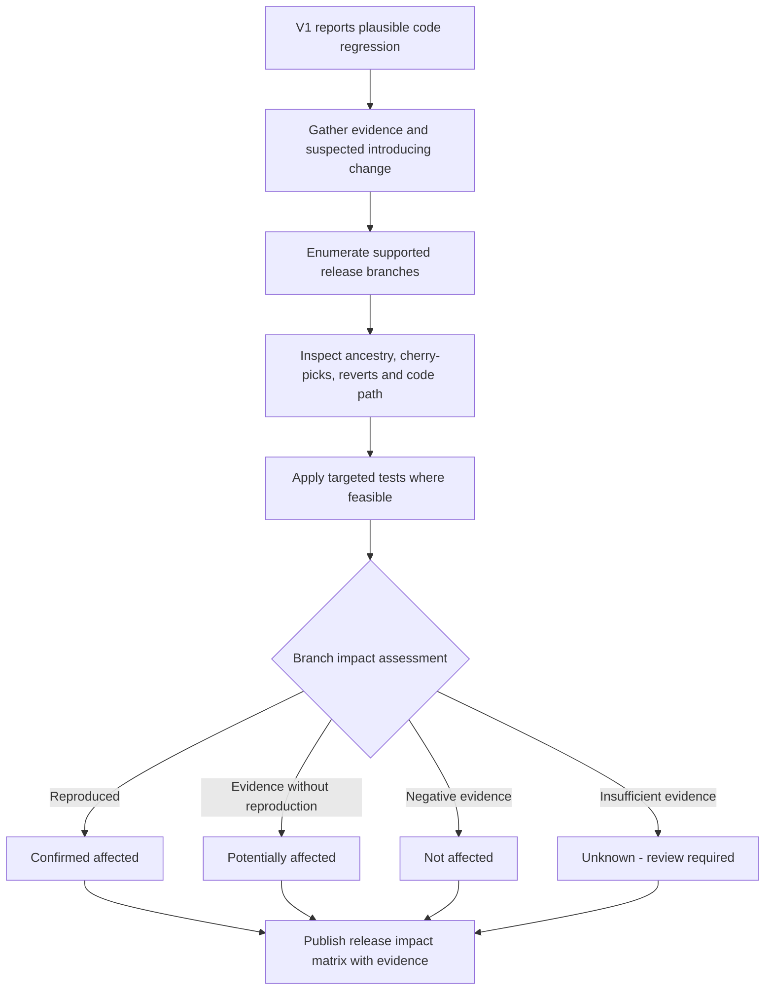
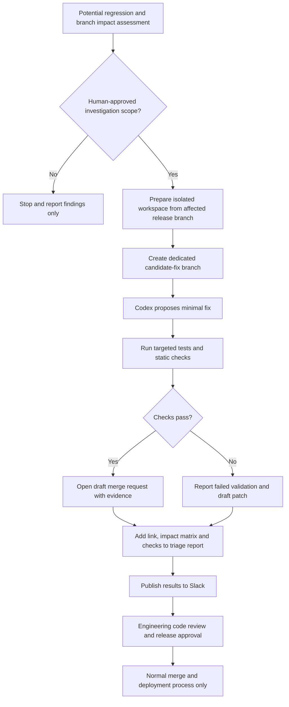

# Planned V2 — release impact analysis and AI-assisted fix proposals

[← README](../README.md) · [Production-used V1](v1-production-case-study.md) · [Architecture](architecture.md)

> **Status: planned only.** None of the branch-impact matrices, automated fix generation, test execution, or draft merge-request creation described here were implemented in the original production Codex skill. These are independent portfolio design proposals, not details of a proprietary implementation.

## Product vision

V1 made issue triage more systematic by supplying historical context and suspected regression leads for human review. A proposed V2 would extend that *advisory* workflow with release-awareness and a safe route from a plausible code-regression hypothesis to a **candidate** patch submitted for human code review.

The objective is not autonomous repair. It is to let engineers more quickly answer three questions:

1. Which *supported release branches* might contain this defect?
2. Can a safe, isolated development environment produce and test a minimal candidate correction?
3. Can reviewers inspect the supporting evidence and a **draft merge request** without granting the skill merge or deploy authority?

## V2a — affected-release assessment

[Editable Mermaid source](diagrams/04-v2-branch-impact.mmd)

### Evidence model

An assessment should preserve the affected product area, stack-trace anchor, suspected introducing change, candidate code path, branch ref, test/reproduction outcome, and relevant backport or revert history.

| Assessment | Definition | Minimum supporting evidence |
| --- | --- | --- |
| Confirmed affected | Defect reproduced or otherwise conclusively demonstrated on that release | Reproduction or reliable test evidence |
| Potentially affected | Relevant code or change is present, but impact has not been demonstrated | Explain missing proof and key assumptions |
| Not affected | Available evidence supports that the relevant behavior is absent or corrected | State reason and testing limits |
| Unknown | Evidence is insufficient or branch cannot be evaluated | No fabricated confidence or default assumption |

**Important:** Presence of the suspected introducing commit is not equivalent to an affected release. Cherry-picks, reverts, backports, feature flags and divergent paths can change actual impact.

### Fictional impact report example

| Synthetic branch | Proposed status | Evidence |
| --- | --- | --- |
| `release/2026.2` | Confirmed affected | Targeted test reproduces failure in a fictional sample application |
| `release/2026.1` | Potentially affected | Similar logic present but reproduction pending |
| `release/2025.2` | Not affected | Illustrative code path absent in sample application |

This example is fictional; these are **not actual enterprise release names or findings**.

## V2b/V2c — candidate fix workflow

[Editable Mermaid source](diagrams/05-v2-fix-proposal.mmd)

### Proposed merge-request evidence

A draft MR should link the triggering issue, suspected root cause and introducing change, affected release(s), exact base branch, minimal proposed patch, tests attempted, pass/fail results, known limitations, and reviewer instructions.

**No automatic merge or production deploy.** If a test fails, a branch cannot be assessed, or the workflow lacks permission, report an incomplete candidate; do not claim an approved fix.

## Required safety gates for any future prototype

- **Explicit authorization** before checking out code in a write-capable workspace or creating a draft MR.
- **Least-privilege access** and branch-level protections; no secrets in model inputs or Slack reports.
- **Isolated environments** for optional application build and test deployment; no direct changes to customer or production systems.
- **Provenance:** Keep references to the triggering issue, suspected commit, branch, generated patch, test results and reviewer decisions.
- **CI and human review:** Do not bypass code review, automated checks, change management, or release-owner approvals.
- **Clear uncertainty:** Mark candidate causes, branch assessments and fixes as recommendations, not verified truth absent supporting evidence.

## Explicitly out of scope

Auto-merge, auto-deploy, customer-data repair, production switch changes, automatic issue reassignment, unreviewed customer notification and claims of guaranteed root-cause accuracy.

## Suggested phased implementation (future work)

| Phase | Outcome | Exit evidence |
| --- | --- | --- |
| V2a — Branch visibility | Per-release impact matrix and supporting source links | Synthetic test repository contains positive, negative and ambiguous cases |
| V2b — Candidate patching | Isolated branch and minimal code-change suggestion | Unit/regression test execution and patch diff available |
| V2c — Draft MR workflow | Draft MR with reproducible findings and Slack link | Successful human review of synthetic cases and authorization checks |

For evaluation before production use, see [Evaluation and safeguards](evaluation-and-guardrails.md).
